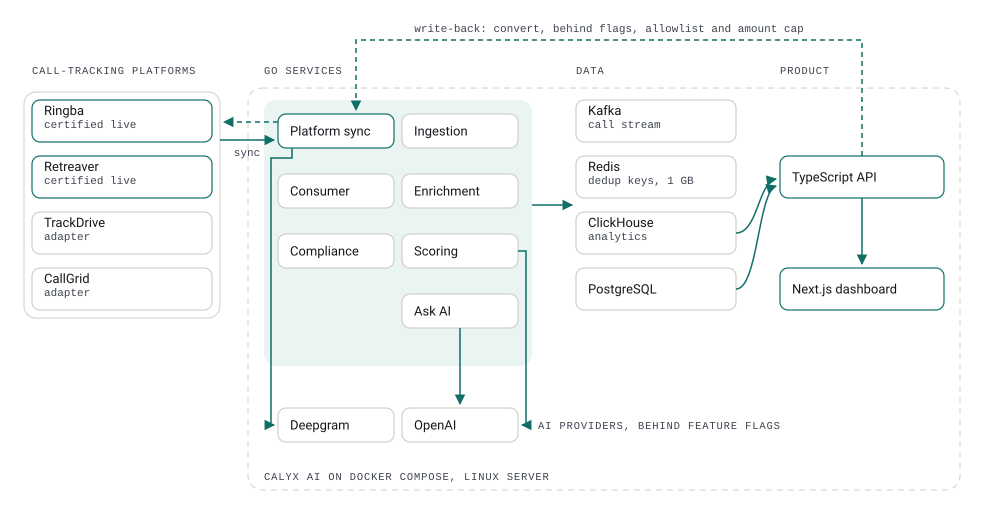

# Calyx AI: multi-tenant call analytics for pay-per-call networks

Case study. Published at `/calyx` on the portfolio site and as [calyx-ai-case-study.pdf](../portfolio-site/public/calyx-ai-case-study.pdf). This README is the source text; the site page and the PDF render the same text from [`portfolio-site/src/data/calyx.ts`](../portfolio-site/src/data/calyx.ts), so a change goes in both. No client names, account data, code or screenshots.

**Role:** sole engineer, end to end (research, architecture, specs, build, live verification, deployment), while working at Devdabs.
**Stack:** Go services (platform sync, ingestion, consumer, enrichment, scoring, ask-ai, compliance), a TypeScript API, a Next.js dashboard, ClickHouse, PostgreSQL, Redis, Kafka, Docker Compose on a Linux server; Deepgram and OpenAI for the AI layer.
**Status:** deployed to production, running on real call data.

## The problem

Pay-per-call networks run their campaigns on several call-tracking platforms. Each platform has its own API, data model and limits. Teams were exporting reports by hand and still could not see one reliable view of calls, payouts and conversions, or act on a call without logging into each platform.

## What I built

- **Platform integrations:** Ringba and Retreaver certified live; adapters for TrackDrive and CallGrid. Per-account API sync with a two-window rate limit, deep-page backfill and incremental refresh.
- **Clean data at volume:** a shared deduplication module with SHA-256 content hashes in Redis, keyed by tenant, platform and call. Unchanged calls are suppressed, changed calls publish an update; on Redis failure it fails open. Redis runs with bounded memory (1 GB, volatile-ttl), so dedup keys stay flat on re-sync.
- **Analytics store:** ClickHouse with ReplacingMergeTree. An analytics table went from about 4.6 million to 3.2 million rows, about 1.4 million duplicates (31%) removed; copying the 4.6 million rows and running OPTIMIZE took about 19 seconds.
- **Write-back:** convert and void calls on the source platform from Calyx AI. Requests come in on the TypeScript API, which forwards them to the Go platform-sync service, and platform sync calls the platform, with tenant isolation, idempotency, an audit trail and read-back confirmation. The convert loop is proven live on Ringba (converted from Calyx, read back `hasConverted=true` with the amount), behind a two-level enable flag, a campaign allowlist and an amount cap.
- **AI layer:** Deepgram transcription, which runs inside platform sync, and OpenAI scoring and Ask AI, called from the scoring and ask-ai services, built and deployed behind feature flags, with cost rules: only converted calls, no backfill, a daily minutes cap.
- **Coverage map:** North America projection with US state and Canadian province normalization.

## How I worked

I ran the build as a phase-gate process. I wrote the plan and acceptance criteria for each phase, and nothing was marked done without live evidence: API probes, data movement confirmed, screenshots. Items that were not verified stayed labelled unknown.

## Hard problems solved

1. **Ping-pong republishing:** the webhook and API-sync paths produced different hashes for the same call, so the same call kept being republished. Fixed by excluding path-specific fields from the canonical hash.
2. **Sticky conversion flag:** the platform's converted flag stays true after a void. A reliable conversion state needs the flag and an amount greater than zero.
3. **Credential leak surface:** caught a metric that could expose tokens inside error strings, and reverted it before release.
4. **Multi-tenant safety:** write-back always uses the calling tenant's own credentials, never a shared integration row.

## Results

- Ringba and Retreaver certified live; TrackDrive and CallGrid adapters built.
- 2,000+ calls a day across two live accounts, after a 30-day backfill.
- About 1.4 million duplicate rows (31%) removed from an analytics table; the 4.6 million row copy and OPTIMIZE took about 19 seconds.
- Convert write-back proven live on Ringba, behind enable flags, an allowlist and an amount cap.
- Deployed and operated by me with Docker Compose on a Linux server.

## Updating

Edit `portfolio-site/src/data/calyx.ts`, then in `portfolio-site/`: `npm run build && npm run export-calyx` (prints the PDF and this folder's `architecture.svg`; needs Playwright with Chromium), and `npm run check-links`.
