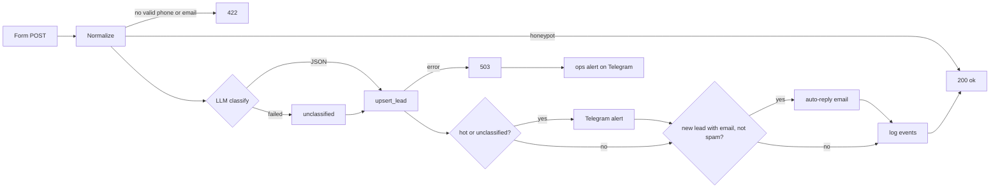

# n8n Lead Automation

[](https://github.com/Syed-Tajdar/ProductionAISystems/actions/workflows/n8n-leads.yml)

Captures leads from a web form, classifies them with an LLM, stores them in Supabase, alerts sales on Telegram for hot leads and follows up automatically.

Spec: [02-n8n-lead-automation.md](02-n8n-lead-automation.md) | Hosting: [DEPLOY.md](DEPLOY.md)

Public demo: a static page on Vercel ([landing/](landing/)) in front of n8n on Render's free plan, in demo mode: the visitor sees what happened to the lead, and the reply email is shown on the page instead of sent.

## Status

| Phase | Scope | State |
| --- | --- | --- |
| 1 | n8n hosting setup, Supabase tables, landing page form | Done |
| 2 | Workflow A without LLM: normalize, dedupe, insert, alert | Done |
| 3 | LLM classification with JSON output and fallback | Done |
| 4 | Auto-reply email, Workflow B (follow-up, daily summary) and C (errors) | Done |
| 5 | Workflow JSON exports, diagram, public demo | Done: exports in `workflows/`, diagram below, demo page in `landing/` |
| 6 | Screenshots and video | Not started |

## Layout

```
docker-compose.yml   n8n 2.45 + Postgres 17 for n8n itself + Mailpit for local email (local, VPS, Railway reference)
render.yaml          the public demo on Render's free plan (n8n data in the Supabase schema n8n)
.env.example         every variable n8n needs, with local defaults
DEPLOY.md            the demo on Render and Vercel step by step, plus n8n Cloud, Railway and Docker
supabase/migrations/ leads and lead_events tables, upsert_lead() for the dedupe, follow-up claim functions
workflows/           n8n workflow JSON, importable as is: lead-intake (A), lead-follow-up and
                     lead-daily-summary (B), lead-errors (C)
tests/               test bench (n8n + mock APIs), workflow tests, SQL tests on Postgres 17, demo page tests
landing/             the demo page: page.html built into public/ with the shared demo UI, Vercel config
```

## Supabase schema

- `leads`: contact fields, LLM fields (`intent`, `urgency`, `language`, `summary`), `status`, `meta` (page URL, UTM tags) and timestamps. `intent` defaults to `unclassified`, which is also the fallback when the LLM step fails.
- `lead_events`: one row per workflow action with a JSON payload: `created`, `updated`, `classified`, `classification_failed`, `alerted`, `alert_failed`, `auto_replied`, `auto_reply_failed`, `followed_up`, `follow_up_failed`.
- `lead_daily_summary` view: new leads, hot leads, won, follow-ups sent and leads awaiting follow-up, for the daily Telegram summary.
- Functions, callable by the service role only: `upsert_lead(lead)` (Workflow A), `claim_follow_ups(max_leads, min_age)` and `finish_follow_ups(results)` (Workflow B), `lead_demo_take(...)` and `lead_demo_take_alert(cap)` (demo mode).
- `lead_demo_requests`: one row per demo submission or demo alert, with a hash of the visitor's address, kept two days. Schema `n8n`: n8n's own tables when it runs on Supabase.
- Phone must be E.164 (`+971500000101`) and email lowercase. At least one of the two is required. Partial unique indexes on both enforce the dedupe rule.
- Row level security is on with no policies: only n8n, using the service role key, can access the tables.

## Workflow A: lead intake

`workflows/lead-intake.json`. The form posts to `/webhook/lead-intake`; the workflow answers only when its work is done.



1. **Normalize:** name and message trimmed; email lowercased; phone to E.164, handling `+971 50 ...`, `00971...`, `050...` (default country code from `LEADS_DEFAULT_COUNTRY_CODE`, 971), Arabic-Indic digits and spaces, dashes or brackets. Source checked against the allowed values; page, UTM tags, submit time and consent go to `meta`.
2. **Reject or ignore:** no valid phone and no valid email answers 422 with the reason. A filled-in honeypot field answers 200 and stores nothing, so bots learn nothing.
3. **Save:** one call to `upsert_lead()` in Supabase. It looks the lead up by phone, then by email, updates or inserts, and writes the `created` or `updated` event, in one transaction. A phone match wins when phone and email point at different leads. A missing phone or email is filled in only if no other lead owns it. Two submissions racing for the same phone end up as one lead: the second hits the unique index and retries as an update.
4. **Classify:** Claude (`claude-haiku-5-5`, effort `low`) or Gemini (`gemini-3.5-flash-lite`), chosen by `llm_provider` in the settings (default `anthropic`). Structured output with a JSON schema: `intent` (buy, rent, info, spam), `urgency` (hot, warm, cold), `language` (en, ar), a one-line English `summary` and a one-sentence `reason` for the urgency (kept in the `classified` event; optional when checking a reply). The reply is checked against the allowed values. The prompt treats the form text as data, not instructions. Haiku because it is one short message and four fields on every submission; the request has a 15 s timeout and one retry.
5. **LLM fallback:** a failed request, a refusal, a cut-off or invalid reply (including a value outside the enums) stores the lead as `unclassified` with a `classification_failed` event holding the error, and still alerts sales. An existing lead keeps its previous classification.
6. **Alert:** hot leads and every unclassified lead, never spam. Telegram message to the sales chat with name, click-to-call number, a WhatsApp link, email, message and source, marked when the lead is returning. Form text is escaped for Telegram's HTML mode.
7. **Auto-reply:** a new lead with an email (not spam, not a returning lead) gets a short thank-you email in its language through n8n's **Send Email** (SMTP) node: English, or Arabic with right-to-left HTML. The lead's own message is not echoed back and the greeting uses the first name only when it looks like a name, so the public form cannot be used to send arbitrary text to someone else's address. No sender configured (`LEADS_EMAIL_FROM` empty) means no email.
8. **Failures:** if Telegram or email fails (after one retry) the lead stays saved, an `alert_failed` or `auto_reply_failed` event is logged with the error, and the form still gets 200. If Supabase fails (after one retry) ops get the contact details on Telegram so the lead is not lost, and the form gets 503 and shows its error message.

Provider and models are set at the top of **Normalize lead**; everything that differs per deployment comes from environment variables (below).

Measured on the test bench with the real Claude API (Supabase and Telegram mocked, five synthetic leads; one run on 14 November 2026, output in [`tests/results/live_llm.json`](tests/results/live_llm.json)): every lead classified with one Claude Haiku call, 1.1 to 3.0 s per submission end to end and $0.000128 per lead on average at list price ($0.000121 to $0.000135, 805 to 844 input and 82 to 103 output tokens); the English rental lead came back hot and was the only one alerted, the Arabic lead `ar`/`buy`, the SEO pitch `spam`, and a message telling the model to rate it hot came back `info`/`cold`.

## Demo mode

`LEADS_DEMO_MODE=true` turns Workflow A into a public demo. Nothing else changes, so the demo runs the same steps as production:

- **Limits before the LLM call:** `lead_demo_take()` allows `LEADS_DEMO_PER_VISITOR` submissions (5) per visitor address in `LEADS_DEMO_WINDOW_MINUTES` (10) and `LEADS_DEMO_DAILY_CAP` (100) per UTC day, under an advisory lock. Over a limit: 429 with `reason` and `retry_after`. Limits unavailable: 503, and no LLM call. The address comes from one header only, `LEADS_CLIENT_IP_HEADER` (default `cf-connecting-ip`): Render's public services sit behind Cloudflare, which sets that header and overwrites any value the caller sent. `X-Forwarded-For` is not read, because proxies append to it and its first entry is the caller's own text. Without the header all visitors share one allowance, so a wrong setting makes the limit stricter, never looser. The address is stored only as a hash; the daily cap is what bounds spending.
- **No email:** the reply email is built exactly as in production and returned in the response instead of sent, because an open form must not send messages to an address someone typed in. Demo leads carry `meta.demo = true`, are never claimed for follow-ups, and are deleted after 7 days.
- **Alerts:** marked **[DEMO]**, and at most `LEADS_DEMO_ALERTS_PER_DAY` (20) a day through `lead_demo_take_alert()`, so the sales phone is not flooded.
- **Response:** `{ok: true, demo: {category, intent, reason, summary, duplicate, alert, alert_message, email, no_email}}`: category `hot`, `warm`, `cold` or `unclassified`; `alert` is `sent`, `not_needed`, `capped` or `failed`; `email` is the preview (to, subject, text, language, direction) or null with the reason in `no_email` (`returning`, `no_email`, `spam`). `alert_message` is the Telegram message exactly as it was sent (HTML with `<b>` and escaped text), only when `alert` is `sent`. Outside demo mode the form still gets `{ok: true}`, and the honeypot always does.

## Workflow B: follow-up and daily summary

Two workflows, each started by a webhook that a scheduled GitHub Actions workflow (`n8n-leads-schedule`, one of the operations workflows listed in the [root README](../README.md#ci)) calls with the shared secret header `X-Scheduler-Token` (checked by the webhook's Header Auth; a wrong or missing token gets 403 and touches nothing). Both also contain a Schedule Trigger that is **disabled**: turn it on only for an always-on local n8n, never together with an outside scheduler.

- **`lead-follow-up.json`**, every 6 hours at `/webhook/lead-follow-up`. `claim_follow_ups()` picks up to 20 leads with status `new`, older than 24 hours, with an email and not spam, and sets them to `followed_up` under a row lock (`for update skip locked`), so a repeated or overlapping Scheduler call cannot email anyone twice. Each lead gets a polite follow-up in its language. `finish_follow_ups()` logs `followed_up` per sent email; a failed email logs `follow_up_failed` and puts the lead back to `new` for the next run, at most 3 times. Answers `{ok, claimed, sent, failed}`; `{"max_leads": 5}` in the body lowers the batch. With `LEADS_EMAIL_FROM` empty it claims nothing (no lead changes status), sends nothing and answers `{ok: true, claimed: 0, sent: 0, failed: 0, skipped: "no_sender"}` with HTTP 200. The demo deployment has no sender on purpose, so every scheduled call there (every 6 hours) answers `skipped: "no_sender"`: that is expected, not a failure.
- **`lead-daily-summary.json`**, daily at 9:00 Asia/Dubai at `/webhook/lead-daily-summary`. Reads `lead_daily_summary` and posts new leads, hot leads, conversions (won), follow-ups sent and leads waiting for a follow-up to the sales chat. Answers with the numbers.

If Supabase or Telegram fails in either one, the run fails: the Actions run turns red and Workflow C tells ops.

**Schedule with GitHub Actions:** set the repository variable `N8N_HOST` (the exact host on the service page in the Render dashboard, `<your-service>.onrender.com`) and the secret `N8N_SCHEDULER_TOKEN` (the Scheduler token below). The workflow calls `/webhook/lead-follow-up` every 6 hours (at :07 past 0, 6, 12 and 18 UTC; each call usually wakes a sleeping n8n on Render's free plan, so this keeps Actions minutes low) and `/webhook/lead-daily-summary` at 8:53 Dubai time; it can also be run by hand from the Actions tab. Without `N8N_HOST` the job is skipped and uses no Actions minutes. GitHub can start scheduled runs a few minutes late; the follow-up claims leads under a row lock, so a late or repeated call emails nobody twice.

**Or Google Cloud Scheduler**, for n8n on Cloud Run (the free tier allows 3 jobs per billing account):

```bash
read -rsp "Scheduler token: " TOKEN; echo
gcloud scheduler jobs create http lead-follow-up --location=europe-west1 \
  --schedule="0 * * * *" --time-zone="Asia/Dubai" --http-method=POST \
  --uri="https://<n8n-host>/webhook/lead-follow-up" --headers="X-Scheduler-Token=$TOKEN"
gcloud scheduler jobs create http lead-daily-summary --location=europe-west1 \
  --schedule="0 9 * * *" --time-zone="Asia/Dubai" --http-method=POST \
  --uri="https://<n8n-host>/webhook/lead-daily-summary" --headers="X-Scheduler-Token=$TOKEN"
unset TOKEN
```

`gcloud scheduler jobs run lead-daily-summary --location=europe-west1` triggers one run by hand.

## Workflow C: errors

`lead-errors.json` starts with n8n's **Error Trigger**. Workflows A and B name it as their error workflow (**Settings > Error workflow**; imported workflows get new ids, so setup-n8n sets it after importing, and so must anyone importing by hand). When one of their runs fails, it posts the workflow name, the failed node and the error message (escaped) to the ops chat. It runs as a separate execution after the failed run has answered, so on Cloud Run it can be slowed by CPU throttling; the one failure that must not wait, a lead that could not be saved, is sent to ops inside Workflow A's own request.

## Settings and credentials

Deployment settings are environment variables on the n8n container, read in the workflows through `$env` (which needs `N8N_BLOCK_ENV_ACCESS_IN_NODE=false`):

| Variable | Used for |
| --- | --- |
| `LEADS_SUPABASE_URL` | Project URL for all Supabase calls |
| `LEADS_BUSINESS_NAME` | Name in prompts and emails |
| `LEADS_SALES_CHAT_ID` | Hot lead alerts and the daily summary |
| `LEADS_OPS_CHAT_ID` | Failed runs (Workflow C) and unsaved leads |
| `LEADS_EMAIL_FROM`, `LEADS_EMAIL_REPLY_TO` | Sender and reply-to of auto-replies and follow-ups; empty sender = no emails |
| `LEADS_DEFAULT_COUNTRY_CODE` | Country code for local phone numbers (971) |
| `LEADS_DEMO_MODE` | `true` for the public demo (see Demo mode) |
| `LEADS_DEMO_PER_VISITOR`, `LEADS_DEMO_WINDOW_MINUTES`, `LEADS_DEMO_DAILY_CAP`, `LEADS_DEMO_ALERTS_PER_DAY` | Demo limits: 5 per 10 minutes, 100 a day, 20 alerts a day |
| `LEADS_CLIENT_IP_HEADER` | Header trusted for the visitor's address, default `cf-connecting-ip` (Render). Only a header your proxy overwrites |

Allowing `$env` lets any workflow on the instance read every environment variable, including n8n's own database password. That is acceptable for a single-owner instance; on a shared instance, keep the settings in the workflows instead.

Credentials in n8n: **Supabase** (Custom Auth, `{"headers": {"apikey": "<secret key>"}}`; new `sb_secret_` keys go in `apikey` only), **Anthropic API** (Header Auth, `x-api-key`), optionally **Gemini API** (Header Auth, `x-goog-api-key`), **Telegram Bot**, **SMTP** (locally: host `mailpit`, port 1025, SSL off, no user) and **Scheduler token** (Header Auth, name `X-Scheduler-Token`, a long random value). The **setup-n8n** GitHub Actions workflow ([`.github/scripts/setup_n8n.py`](../.github/scripts/setup_n8n.py)) creates all six through the n8n public API, imports and publishes the four workflows with their credentials and error workflow, and checks the webhooks. Before it writes anything it checks the host: `/healthz` must answer and `N8N_API_KEY` must be accepted, otherwise it stops and says the host may not be your instance. It is safe to run again: each rerun ends with the same six credentials. On a standard n8n they are updated in place; where an instance cannot list or update credentials it makes fresh copies, records them in an inactive workflow ("setup-n8n credential ledger") and deletes the old ones. `tests/test_setup_n8n.py` runs it twice against a fresh n8n 2.45, and against a fake n8n whose API differs in the ways listed below.

## Hosting on Render: what to know

- **Use the exact URL.** Render may add a suffix to the service name (`n8n-leads-<suffix>.onrender.com`) when the plain name is taken, and the plain name can be someone else's n8n. `N8N_HOST`, `N8N_WEBHOOK_URL` and `LEAD_WEBHOOK_URL` must all use the address shown on the service page in the Render dashboard; this README and DEPLOY.md write it as `<your-service>.onrender.com`. Sign up as the n8n owner only on that address.
- **Fallbacks for instances whose public API differs.** Our instance is a standard n8n 2.45: setup-n8n updates its credentials in place. For an instance that answers differently (one met on another host), setup-n8n also handles: no credential list or update (405), so it replaces credentials and rewires the nodes; a read-only credential id; a missing publish route (404), so it activates instead; activation that finishes after the request, so it reads each workflow back until it is active; a firewall that blocks plain JSON bodies, so every body is gzip-compressed; and HTML error pages, reported as plain text. Details in [DEPLOY.md](DEPLOY.md#fallbacks-for-instances-whose-public-api-differs).
- **The first activation is slow** on the free plan (0.1 CPU): with the wake-up, the first setup-n8n run can take 20 minutes.
- **Reading errors:** the read-only **n8n-errors** workflow (script: [`.github/scripts/n8n_errors.py`](../.github/scripts/n8n_errors.py)) prints the latest executions with their failed nodes and error outputs, secrets and lead data masked, without opening the n8n editor.

## Next step: email intake

Email intake is not built. The spec's Gmail trigger polls the inbox on a timer, which needs an always-on n8n and does not fit a host that sleeps. The planned route is push-based: Gmail API `watch` publishes new-mail notifications to Google Pub/Sub, a push subscription calls an n8n webhook, and that workflow fetches the message, maps it to the same lead fields with `source = email` and hands it to the Workflow A steps. On the local Docker setup the Gmail Trigger node works as is.

## Design rules for a host that sleeps

n8n runs on Render's free plan, which stops the instance when it is idle and starts it on the next request. The same rules fit any scale-to-zero host, such as Cloud Run with request-based billing, where CPU is only available while a request is open.

- Every workflow starts from a webhook and finishes its work before responding (`Respond to Webhook` is the last node). Nothing runs after the response.
- Anything scheduled (Workflow B: follow-ups, the daily summary) gets a webhook that an outside scheduler (GitHub Actions here, or Google Cloud Scheduler) calls with a shared secret header. n8n's own Schedule Trigger stays in those workflows only as an option for the always-on local Docker setup.
- Polling triggers (such as the Gmail trigger) do not fit; email intake needs a push into a webhook instead.

## Demo page

`landing/` is the public demo page, static on Vercel. `page.html` is rendered with the shared demo UI macros (`demo-ui/`: top bar, "What this demo shows" card, states, footer) into `public/index.html` by `build.py`, and the built page is committed, so Vercel needs no Python. The Vercel build (`build-config.mjs`) only writes `public/config.js` from the `LEAD_WEBHOOK_URL` environment variable and fails without it.

- Opening the page sends a no-cors request to n8n's `/healthz`, which wakes a sleeping n8n while the visitor reads.
- The form posts `application/x-www-form-urlencoded`, a simple CORS request with no preflight: `name`, `phone`, `email`, `message`, `consent`, `source=web_form`, `page`, `submitted_at`, UTM tags, and the hidden `company` honeypot.
- While n8n starts, the page shows a calm "starting up" message, retries the 404 (routes or webhook not registered yet; before the routes exist the 404 has no CORS header, so the browser reports a failed request, which is retried too unless the visitor is offline) and the host's 502 to 504 answers, and waits up to 6 minutes. A JSON answer from the workflow is final.
- The result is a timeline of the steps the workflow reports: Sorted (category, intent and reason), Repeat check, Sales alert (with a preview of the Telegram message exactly as sales received it, from `alert_message`, when it was sent) and Reply email (shown with the note that it is not sent). Everything from the server is written as text, never as HTML. **Try another example** resets the form and scrolls back up. The CSP allows scripts and styles from the page itself, and requests and form posts to `*.onrender.com` only.
- Without script the form still posts: the Vercel build writes the webhook into its `action`, the browser checks the required fields, and the visitor sees the workflow's raw JSON answer.
- Example buttons fill in made-up leads with a random number, so the first send is new and a second send shows the repeat check.

```bash
pip install jinja2 && python3 landing/build.py   # after editing page.html (CI runs --check)
python3 -m http.server 8080 -d landing/public     # set public/config.js to a local webhook first
```

## Run locally

```bash
cp .env.example .env    # set N8N_ENCRYPTION_KEY, POSTGRES_PASSWORD and the LEADS_* values
docker compose up -d
curl localhost:5678/healthz
python3 -m http.server 8080 -d landing/public   # demo page; set public/config.js to the local webhook
open http://localhost:8025               # Mailpit: every email the workflows send
```

## Tests

```bash
python3 tests/bench/harness.py up                  # n8n on :5680 with the workflows loaded
python3 -m unittest discover -s tests -v            # workflow tests + SQL tests (Docker)
python3 tests/bench/harness.py down
```

One test (`tests/test_smoke_browser.py`) opens the demo page in Chromium, served with the headers from `landing/vercel.json`, sends an example enquiry to a stand-in for the webhook and checks the result timeline. It fails on any script error or blocked resource, needs `pip install playwright && playwright install chromium` once, and is skipped when Playwright or its browser is not installed, except in CI.

The workflow tests run a mock of Supabase, Claude, Gemini and Telegram, and a small SMTP server, inside the test process; n8n reaches them at `host.docker.internal:8091` and `:2525`. They cover normalization, rejects, the honeypot, the Claude and Gemini request formats, the alert rules, auto-replies in both languages and when not to send them, follow-ups, the daily summary, the scheduler token, the error workflow, and failures of the LLM (error status, rate limit, refusal, invalid or cut-off JSON), Telegram, email (a rejected recipient) and Supabase. Every workflow with an `llm_provider` setting is also loaded as a Gemini copy on `/webhook/lead-intake-gemini`, and Workflow A as a demo-mode copy on `/webhook/lead-intake-demo` (`test_demo.py`: limits, 429 and 503, no email sent, the email preview in both languages, repeat leads, the alert cap). `test_landing.py` checks that the built demo page is current, carries the demo notes, has no inline code, and that the Vercel config step accepts only an https webhook URL.

Live Claude check, synthetic leads only. The mock relays Claude calls and adds the key from the test process, so it is never stored in n8n:

```bash
ANTHROPIC_API_KEY=<key> LIVE_ANTHROPIC=1 python3 -m unittest tests/test_live_llm.py -v
```

`test_sql.py` applies the migrations to a throwaway Postgres 17 container and tests the functions: the dedupe (including a forced race between two sessions), the follow-up claim (including two overlapping runs), the retry limit, the summary view and the grants.

## Verified

- `docker compose up` with Postgres 17: both containers healthy, `/healthz` returns `{"status":"ok"}`. Without `N8N_ENCRYPTION_KEY` the stack refuses to start.
- Migration applied to Postgres: dedupe upsert by phone, `updated_at` trigger, summary view, check constraints (phone format, lowercase email, phone or email, intent and event values), cascade delete, and RLS (anon role reads 0 rows).
- `docker compose up` with Mailpit: an email sent from the n8n container to `mailpit:1025` (Arabic subject) shows up in Mailpit's API.
- Landing page against a running n8n webhook in Chromium (desktop and mobile): validation messages, successful submit, every field (including Arabic text and UTM tags) received in the n8n execution.
